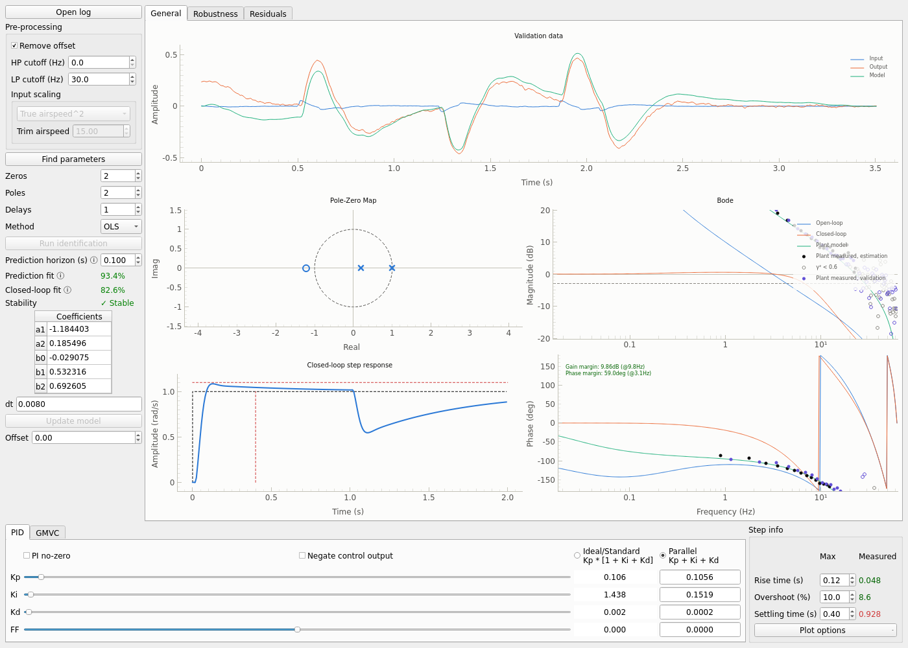
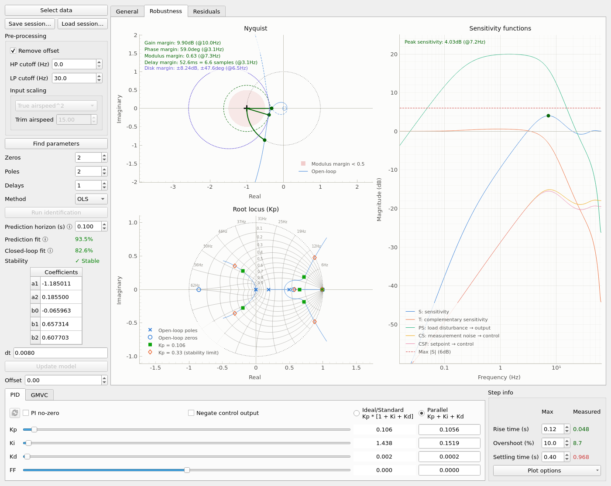
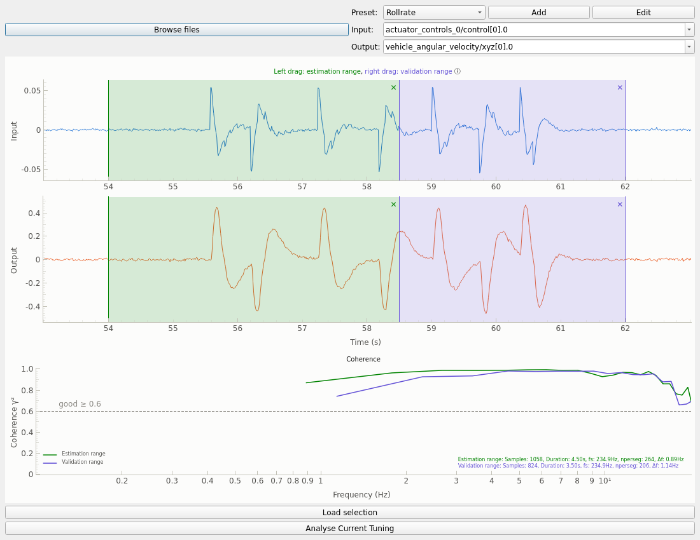
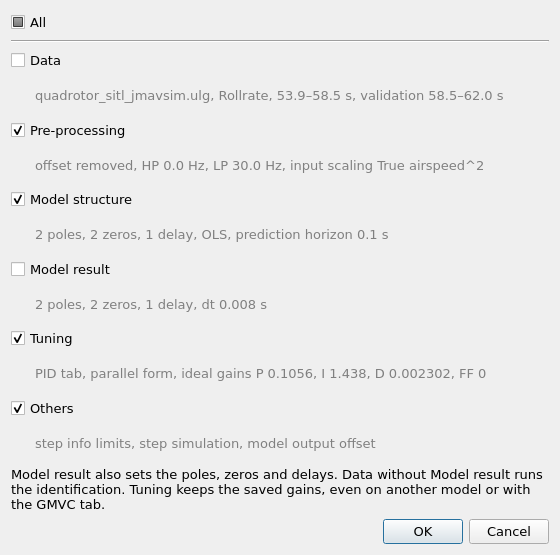

# Installation

Poetry and uv both create the environment and install the dependencies.

## Using Poetry (recommended)
1. Get [poetry](https://python-poetry.org/docs/): `curl -sSL https://install.python-poetry.org | python3 -`
2. In this directory, run `poetry install`
3. Start the GUI: `poetry run python3 autotune.py`

## Using uv
1. Get [uv](https://docs.astral.sh/uv/): `curl -LsSf https://astral.sh/uv/install.sh | sh`
2. In this directory, start the GUI: `uv run autotune.py`. The first run installs the dependencies.





# Tuning Worflow

## Fixed-Wing Rate Tuning

**Prerequisites**:

- Requires valid airspeed measurement on vehicle
- Correctly set FW_AIRSPD_TRIM

### Flight Maneuvers

Ensure your vehicle passes the pre-tuning test as outlined [here](https://docs.px4.io/main/en/config/autotune_fw.html#pre-tuning-test).

#### Use automated maneuvers (Recommended)

1. Configure your setup to use the PX4 autotune maneuvers without applying the identified gains online:

```
   FW_AT_APPLY = Do not apply the new gains (logging only) 
   FW_AT_AXES = 7  # Enables maneuvers on all three axes (adjust as needed) 
   FW_AT_SYSID_F1 = 10
   FW_AT_SYSID_TYPE = Logarithmic sine sweep
```

2. Enable an [autotune switch](https://docs.px4.io/main/en/config/autotune_fw.html#enable-disable-autotune-switch) on your RC transmitter. 
3. Follow the procedure described [here](https://docs.px4.io/main/en/config/autotune_fw.html#auto-tuning-procedure) to perform the maneuvers.
Since FW_AT_APPLY is set to logging only, step 5 of the procedure (applying new gains and testing) will not be executed.

#### Perform manual maneuvers

Perform these maneuvers separately for each axis: roll, pitch, and yaw.

1. Fly in stabilized mode and start from level flight.
2. Apply a manual sine chirp input (sine wave with increasing frequency) on the selected axis. Avoid any other control inputs simultaneously.
3. For pitch and yaw: The amplitude of the input should not be too high, but should be enough to overcome noise.
4. Repeat the maneuver a few times if necessary to capture good data.

### Using the Tool

#### Load the flight log and select the relevant tuning loop (roll, pitch, or yaw):



#### Window selection:

1. Select the portion of the log where the maneuver occurred with a left drag: the estimation range, which the model is fitted to.
2. Ensure the window starts from level flight and covers the full maneuver.
3. (Optional) Select another maneuver with a right drag: the validation range. The model is then judged on data it was not fitted to (fits, residuals and *Find parameters*): a model that fits the noise of the estimation range does not fit other data. Without a validation range, the model is judged on the estimation range.
4. The ✕ in the corner of a range removes it.
5. (Experimental) Use the coherence plot to check whether your input-output data have a strong enough linear relationship at the desired frequencies. It shows the coherence of each range in its color. For fixed-wings: \
   i. We are interested in frequencies between 0.5-10Hz. \
   ii. Values > 0.6 are sufficient. \
   iii. If the coherence function is oscillating dramatically, the identified model may be unreliable at those frequencies.
6. Once you have identified the window, load the selection into the tool.

<table>
  <tr>
    <td align="center">
      <b>Good window selection</b><br>
      <br>
      <i>Starts from level flight and covers the full maneuver. Coherence is sufficient.</i>
    </td>
    <td align="center">
      <b>Bad window selection</b><br>
      <br>
      <i>Does not isolate the maneuver. Coherence is insufficient. </i>
    </td>
  </tr>
</table>

#### Model Verification

1. Check that the estimated dynamic model correctly tracks the actual aircraft output.
   The model curve is the simulation of the model from the logged input; it can drift away
   from the output for a model with an integrator, such as a rate loop. The prediction fit
   compares instead the output predicted one *prediction horizon* ahead from the logged data:
   about the time scale of the loop (the default 0.1 s suits a rate loop, a slower loop needs
   a longer horizon). A longer horizon turns the prediction into the drifting simulation.
   With a preset that has the flown gains, the closed-loop fit replays the logged reference
   through the model and these gains.
   With a validation range, the fits, the model curve and the residuals are those of the
   validation range. The Bode shows the plant measured on both ranges: a model can only fit
   both if they agree, otherwise the plant differs between the maneuvers or one of them is
   poorly excited.
   *Find parameters* picks the orders of least predicted squared error: the mean squared
   error of the prediction plus, for each parameter of the model, the output variance divided
   by the number of samples (Morelli's criterion). A higher order must improve the prediction
   by more than this share of the output variance, otherwise it only fits the noise.
   With a validation range, it picks instead the orders of least mean squared error of the
   prediction of the validation range (cross-validation): a parameter that only fits the
   noise of the estimation range does not predict the validation range, so it needs no
   penalty.
2. If not, adjust the system order (number of poles and zeros) and/or delay parameters.
3. Verify that the system is minimum-phase (i.e., zeroes lie inside the unit circle).


#### Tuning Gains

The PID tab starts from the gains flown in the log, when the preset gives them. Once you
tune them, selecting other data asks whether to replace your tuning with the gains flown in
that log (when it gives them), otherwise your gains are kept to try them on it. The reload
button at the top left of the PID tab restores the flown gains and PID options: it is enabled
while they differ from yours.

1. Set all gains to zero
2. Increase the P-gain until the step response shows oscillations. Then reduce the P-gain by approximately 50%:

   <b>Increase P-gain</b><br>
   

   <b>Decrease by 50%</b><br>
   

3. Adjust the I-gain to achieve a good step response with acceptable steady-state error.

   

4. Fine-tune both gains as needed. At the 1 second mark, a disturbance is injected into the system. The tuned response to this disturbance is visible in the step response plot.

5. Use the Bode plot to confirm that the resonant frequency peak remains below 0dB.

   

### Sessions

*Save session…* writes the state of the tool to a YAML file, and *Load session…* restores
it. Both let you choose the groups to save or load:



| Group | Content |
|-------|---------|
| Data | Log (path relative to the session, absolute path and SHA-256), preset, input and output signals, estimation and validation ranges |
| Pre-processing | Offset removal, HP and LP cutoffs, input scaling, trim airspeed |
| Model structure | Poles, zeros, delays, method, prediction horizon |
| Model result | Coefficients, delay and sample time of the model, as identified or edited |
| Tuning | PID or GMVC tab, gain form, gains, PID options, GMVC sliders |
| Others | Step info limits, step simulation, model output offset |

Loading the whole session reproduces the saved state: the model is restored, not identified
again. Loading only some groups carries them over to the current state, e.g. the tuning of a
session onto the model of another log. Then:
- The gains are kept as saved, even with the GMVC tab active, until a GMVC slider moves.
- Model result also sets the poles, zeros and delays.
- Data without Model result runs the identification, as *Select data* does.
- A model loaded without its data, pre-processing and structure enables *Run identification*:
  it may not be the model these settings identify.
- A model loads without data too: the plots of the closed loop are shown, the fits are not.

The log is looked for next to the session first, so a folder holding both can be moved or
shared. A log that differs from the saved one is only loaded once confirmed.

### Applying the Gains

1. The gains shown in the parallel form correspond to the PX4 rate controller parameters.
   

   For parameters in other units, set the preset's gain scale (e.g. 0.001 for `ICE_IDLE_RPM_P` and `ICE_IDLE_RPM_I`, defined per 1000 rpm): the PID tab then shows and edits the gains in parameter units.

2. If the identified parameters are strongly different to the currently set ones (more than 30% for multiple axes), an incremental application while flying is recommended (not prior to takeoff, during takeoff, or during landing).

3. For all loops tuned with the strategy outlined in this guide: increase the respective integrator limit parameters to 1 (FW_RR_IMAX, FW_PR_IMAX, FW_YR_IMAX).
